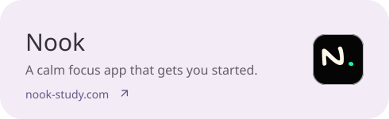
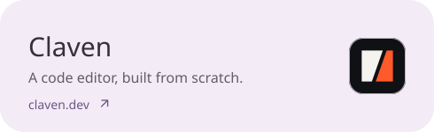

## hey, i'm adam 👋

I go by **Eleco** online. Developer from Morocco 🇲🇦

- Previously a **software engineering intern at a YC startup**
- Currently working on **B2B software**
- Doing **competitive programming** in C++, training for the informatics olympiad ([IOI-Prep](https://github.com/adamsaou/IOI-Prep) · [Codeforces](https://codeforces.com/profile/Adam.Saoudani))
- On the **Moroccan National Debate Team**

### what i'm building

<p align="center">
  <a href="https://nook-study.com"><picture><source media="(prefers-color-scheme: dark)" srcset="assets/nook-dark.svg" /></picture></a>
  <a href="https://claven.dev"><picture><source media="(prefers-color-scheme: dark)" srcset="assets/claven-dark.svg" /></picture></a>
</p>

### my setup

```
eleco@cachyos
─────────────
laptop    HP Laptop 15 (fc0xxx)
cpu       AMD Ryzen 7 7730U (8 cores / 16 threads)
gpu       AMD Radeon (integrated)
ram       16 GB
storage   512 GB Samsung NVMe, btrfs
displays  15.6" 1366x768 + Dell P2419HC 24" 1080p

os        CachyOS
kernel    linux-cachyos 7.2
wm        Hyprland (Wayland)
shell     Caelestia
terminal  foot + fish
editor    Neovim
```

> *This is the laptop my mom saved up for months and months to get me. Thanks, mom ❤️*
